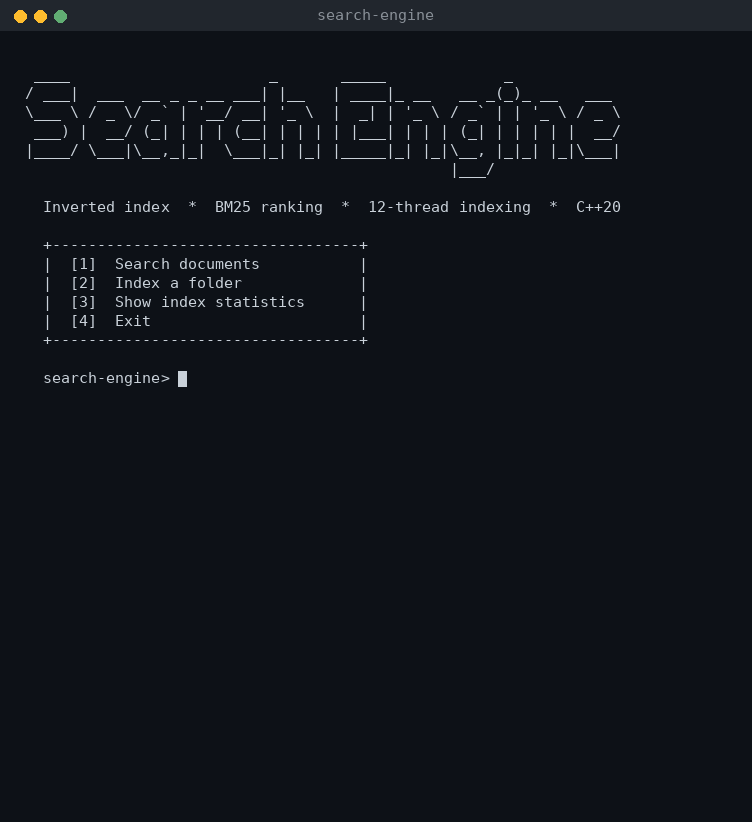
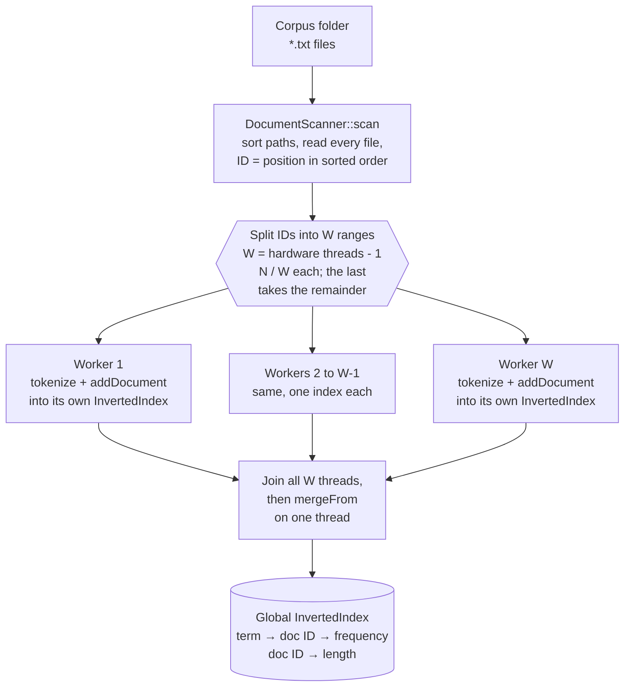
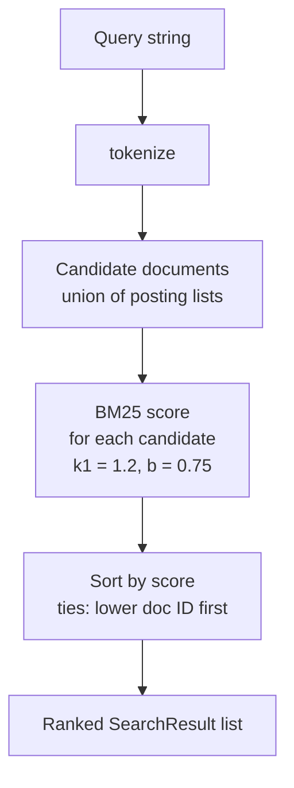

# C++ File Search Engine

A full-text search engine for local text files, written from scratch in modern C++20. It builds an inverted index over a folder of `.txt` documents, ranks matches with the **Okapi BM25** relevance function, and splits indexing across **one worker thread per hardware thread, minus one** (11 on a 12-thread CPU). Each worker builds a private index before a single-threaded merge.

It runs as an interactive console program: index any folder, search it, and inspect index statistics. The project uses no third-party libraries — only the C++ standard library — and is developed with MSVC in Visual Studio on Windows.



<sub>Demo recorded from a real run on a 2-core Linux VM, so indexing is slower there than in the [benchmarks](#benchmarks).</sub>


-5C2D91)

[](LICENSE)

## Contents

- [Features](#features)
- [Architecture](#architecture)
- [Indexing pipeline](#indexing-pipeline)
- [Search pipeline](#search-pipeline)
- [Technology](#technology)
- [Requirements](#requirements)
- [Building and running](#building-and-running)
- [Usage](#usage)
- [Benchmarks](#benchmarks)
- [Repository structure](#repository-structure)
- [Limitations](#limitations)
- [Roadmap](#roadmap)
- [License](#license)

## Features

| Feature | Implementation |
| --- | --- |
| Document discovery | Scans one folder (non-recursive) for regular `.txt` files and sorts the paths, so document IDs are deterministic between runs. |
| Tokenization | Lower-cased runs of ASCII letters and digits; keeps `+` and `#` attached to a word, so `C++` and `C#` stay searchable. |
| Inverted index | `term → {document ID → term frequency}`, plus the token length of every document. |
| BM25 ranking | Okapi BM25 with `k1 = 1.2` and `b = 0.75`, using a non-negative IDF. |
| Keyword search | Returns every document that contains at least one query term, sorted by score. |
| Parallel indexing | `std::jthread` workers created in a loop, each with its own `InvertedIndex`; no locks are needed during indexing. The worker count comes from `std::thread::hardware_concurrency()` at runtime. |
| Progress bar | A live indexing bar driven by a shared `std::atomic` counter that the workers increment. |
| Interactive CLI | A menu to index any folder, search it (top 10 results), and view index statistics and throughput. |

## Architecture

| Component | Files | Responsibility |
| --- | --- | --- |
| `DocumentScanner` | `DocumentScanner.h/.cpp` | Lists `.txt` files in a folder, sorts them, and reads each file into a `Document { path, text }`. |
| `tokenize()` | `Tokenizer.h/.cpp` | Splits text into normalized tokens. Used for both documents and queries. |
| `InvertedIndex` | `InvertedIndex.h/.cpp` | Stores postings and document lengths, answers term/document statistics, and merges another index into itself (`mergeFrom`). |
| `BM25Ranker` | `BM25Ranker.h/.cpp` | Scores one document against a query using statistics from the index. |
| `SearchEngine` | `SearchEngine.h/.cpp` | Owns the documents, the index and the ranker. Its constructor runs the indexing pipeline and draws the progress bar; `search()` runs the query pipeline. |
| `Cli` | `Cli.h/.cpp` | The interactive menu: reads input, builds or replaces the `SearchEngine` (held in a `std::optional`), and prints results and statistics. It reads and writes through injected `std::istream&`/`std::ostream&`, so it can be driven by string streams. |
| `main` | `main.cpp` | Creates a `Cli` on `std::cin`/`std::cout` and runs it. |

**Indexing** runs once, in the `SearchEngine` constructor:



**Search** runs for every query, in `SearchEngine::search`:



## Indexing pipeline

All indexing happens in the `SearchEngine` constructor.

1. **Scan.** `DocumentScanner::scan` iterates the folder with `std::filesystem::directory_iterator`, keeps regular files whose extension is `.txt`, and sorts the paths. Each file is read in full into a `std::string`. A file that cannot be opened is reported on `stderr` and skipped. A document's ID is its position in this sorted list.
2. **Choose the worker count and partition.** The worker count `W` is `std::thread::hardware_concurrency() - 1`, leaving one hardware thread for the main thread, which draws the progress bar. If the function returns 0 (unknown) or 1, `W` is 1, so a worker count of zero, or an unsigned wrap-around, can't happen. The constructor prints `Using W worker threads`. The document list is then split into `W` contiguous ID ranges of `N / W` documents (integer division), and the last worker also takes the remainder, so every document is indexed exactly once even when `N` is not a multiple of `W`. On a 12-thread CPU with the 10,000-document benchmark corpus, `W` is 11: workers 1–10 index 909 documents each and worker 11 indexes 910.
3. **Index in parallel.** A loop starts one `std::jthread` per range and stores it in a `std::vector<std::jthread>`. Each thread's lambda captures its worker number and its `begin`/`end` range **by value**, and the shared document list, worker indexes and progress counter by reference. Each thread loops over its range and calls `addDocument` on its own entry of a `std::vector<InvertedIndex>`. That call tokenizes the text, records the document's token count (adding it to a running total), and increments `postings[token][documentId]`. The workers only *read* the shared document list and only *write* to their own index, so this stage needs no mutexes.
4. **Report progress.** After each document, a worker increments a shared `std::atomic<std::size_t>` counter (relaxed ordering; it is only a progress count). Meanwhile the calling thread redraws the progress bar every 50 ms and stops once the counter reaches `N`, so the final 100% frame is always drawn.
5. **Join.** The constructor joins every thread in a loop before the local indexes are merged. `std::jthread` would also join automatically when the vector is destroyed, but that happens at the end of the constructor, after the merge, so the explicit join is required.
6. **Merge.** On the calling thread, `mergeFrom` copies each worker's document lengths and postings into the global index and adds its token total. Document ID ranges never overlap, so merging is plain insertion with no conflict resolution.

Scanning, file reading and merging all run on one thread; only tokenization and posting construction run in parallel. The running token total makes the average document length used by BM25 a single division instead of a loop over every document.

## Search pipeline

`SearchEngine::search(query)`:

1. **Tokenize** the query with the same tokenizer used for documents.
2. **Collect candidates:** the union of the posting lists of every query term. A document matches if it contains *any* query term (OR semantics).
3. **Score** each candidate with `BM25Ranker::scorer`. Repeated query terms are counted once.
4. **Rank** by score, highest first; equal scores are ordered by document ID.
5. **Return** every candidate as a `SearchResult { documentId, bm25Score, filePath }`. The CLI prints the top 10 and the number of remaining matches.

The score for document $D$ and query $Q$ is

$$
\text{score}(D, Q) = \sum_{t \in Q} \text{IDF}(t) \cdot \frac{f(t, D)\,(k_1 + 1)}{f(t, D) + k_1 \left(1 - b + b \cdot \frac{|D|}{\text{avgdl}}\right)}
\qquad
\text{IDF}(t) = \ln\!\left(1 + \frac{N - n(t) + 0.5}{n(t) + 0.5}\right)
$$

where $f(t, D)$ is the number of times term $t$ appears in $D$, $|D|$ is the document's length in tokens, $\text{avgdl}$ is the average document length, $N$ is the number of documents, and $n(t)$ is the number of documents containing $t$. The constants are $k_1 = 1.2$ and $b = 0.75$.

## Technology

| Area | Details |
| --- | --- |
| Language | C++20 (`/std:c++20`), conformance mode (`/permissive-`) |
| Compiler / IDE | MSVC, Visual Studio platform toolset **v145**, solution file `C++File_Search_Engine.slnx` |
| Concurrency | `std::jthread` (in a `std::vector`), a `std::vector` of per-worker `InvertedIndex` objects, `std::atomic` progress counter |
| Data structures | `std::unordered_map`, `std::unordered_set`, `std::vector` |
| File I/O | `std::filesystem::directory_iterator`, `std::ifstream` |
| Output and state | `std::format`, `std::optional`, `std::string_view` |
| Timing (benchmark) | `std::chrono::steady_clock` |
| Dependencies | None beyond the standard library |

## Requirements

| To | You need |
| --- | --- |
| Build on Windows (primary) | Visual Studio 2026 with the **Desktop development with C++** workload. The project targets platform toolset **v145**, `/std:c++20`. |
| Build on Linux | GCC 13 or newer (Clang 18 also tested), using C++20 and `-pthread`. |
| Run | A folder of `.txt` files to index. The 10,000-document benchmark corpus (about 100 MiB) is **not** included in the repository. |

No third-party libraries, package managers or downloads are needed.

Older Visual Studio versions have not been tested. With Visual Studio 2022, open the project's properties and set **Platform Toolset** to **v143**. If your Visual Studio can't open the `.slnx` solution file, open `C++File_Search_Engine/C++File_Search_Engine.vcxproj` directly. macOS has not been tested.

## Building and running

### Windows (Visual Studio)

1. Clone the repository:

   ```powershell
   git clone https://github.com/jagritsinghsheoran-bit/cpp-file-search-engine.git
   ```

2. Open `C++File_Search_Engine.slnx` in Visual Studio.
3. Select the **Release | x64** configuration and build with **Build → Build Solution** (`Ctrl+Shift+B`).
4. Run with **Debug → Start Without Debugging** (`Ctrl+F5`). The executable is written to `x64\Release\C++File_Search_Engine.exe`.

### Linux (GCC or Clang)

From the repository root:

```bash
g++ -std=c++20 -O2 -pthread -I C++File_Search_Engine/include C++File_Search_Engine/src/*.cpp -o search-engine
./search-engine
```

`benchmarks/Benchmark.cpp` is left out of this command; it is a separate program (see [Running the benchmark](#running-the-benchmark)).

## Usage

The program starts at a menu:

```text
   +----------------------------------+
   |  [1]  Search documents           |
   |  [2]  Index a folder             |
   |  [3]  Show index statistics      |
   |  [4]  Exit                       |
   +----------------------------------+

   search-engine>
```

| Option | What it does |
| --- | --- |
| **[2] Index a folder** | Asks for a folder and indexes every `.txt` file directly inside it, showing a live progress bar and the indexing time. Pressing Enter reuses the last folder; re-indexing the loaded folder asks for confirmation first. An invalid path prints `Not a folder` instead of crashing. |
| **[1] Search documents** | Asks for queries, one per line, and prints the top 10 results with their BM25 scores and how many more matched. An empty line returns to the menu. Requires an index. |
| **[3] Show index statistics** | Shows the folder, document count, corpus size, unique terms, total tokens, average document length, indexing time, documents/s and MiB/s. |
| **[4] Exit** | Quits. The program also exits cleanly when input ends. |

Example session on the benchmark corpus:

```text
   search-engine> 2

   Folder to index: C:\SearchEngineBenchmarkCorpus
   Indexing C:\SearchEngineBenchmarkCorpus ...
   Using 11 worker threads
   [##############################] 100%  10000 / 10000
   Indexed 10000 documents in 2.31 s.

   search-engine> 1

   Enter a query (empty line returns to the menu)
   query> mutex deadlock

    1.  document_08340.txt        6.1868
    2.  document_05121.txt        6.1069
    3.  document_02246.txt        6.0937
   ...
   10.  document_01878.txt        5.8508
       ...and 3663 more
```

The indexing time above is illustrative; it depends on the machine and on whether the files are already in the OS cache.

Queries are case-insensitive and punctuation is ignored, so `Mutex, DEADLOCK!` is equivalent to `mutex deadlock`. A document matches if it contains any query term.

## Benchmarks

### Method

| Item | Value |
| --- | --- |
| What is timed | Construction of `SearchEngine`: folder scan, reading every file, tokenization and indexing, and merging the worker indexes. Query time is **not** included. |
| Timer | `std::chrono::steady_clock`, around the constructor call (`benchmarks/Benchmark.cpp`) |
| Build | Release, x64, MSVC (toolset v145) |
| Corpus | 10,000 synthetic `.txt` documents, 100.0072 MiB in total, at `C:\SearchEngineBenchmarkCorpus` |
| Hardware | Intel Core i5-12450H: 8 cores (4 performance + 4 efficient), 12 threads |
| Repetitions | 5 runs per configuration; the median is reported |
| Cache state | Likely warm: the corpus had been read recently, so files were probably served from the OS file cache. Cold-cache performance was not measured. |

Each worker count was measured with the commit that introduced it, when the count was fixed in the code. Every multi-worker version uses the same design (contiguous ranges, per-worker indexes, merge after join); only the number of workers differs.

These runs were recorded before the progress bar, the interactive menu and the runtime worker count were added. The current code uses `hardware_concurrency() - 1` workers, which is **11** on this CPU, a count not in the table. It also updates an atomic counter per document and redraws the progress bar every 50 ms. Its timings have not been re-measured yet.

### Results

| Workers | Median time (s) | Fastest – slowest (s) | Throughput at median (MiB/s) | Speedup vs. sequential |
| ---: | ---: | :---: | ---: | ---: |
| 1 (sequential) | 3.2403 | 3.2078 – 3.3270 | 30.86 | 1.00× |
| 2 | 3.1880 | 3.1608 – 3.2399 | 31.37 | 1.02× |
| 4 | 2.6227 | 2.6205 – 2.7626 | 38.13 | 1.24× |
| 8 | 2.3858 | 2.3575 – 2.4132 | 41.92 | 1.36× |
| **12** | **2.2973** | **2.2464 – 2.3174** | **43.53** | **1.41×** |

Speedup is the sequential median divided by the configuration's median. Every individual run is listed in [`benchmarks/results.csv`](C++File_Search_Engine/benchmarks/results.csv), with a console screenshot of each run in [`benchmarks/screenshots`](C++File_Search_Engine/benchmarks/screenshots) (one folder per configuration, `run1.png`–`run5.png` matching the CSV run numbers).

### Interpretation

- With 12 workers, indexing the corpus takes a median of 2.30 s instead of 3.24 s, which is **1.41× faster**. That is a real but modest gain for 12 hardware threads.
- Two workers made almost no difference: their run times overlap the sequential runs' range.
- Most of the improvement arrives by 4 workers, and each step after that adds less.
- The code was not profiled, so the causes of the limited scaling are not established. Likely contributors are:
  - the parts of construction that are still single-threaded: scanning, reading every file, and the final merge;
  - the large number of small heap allocations made when filling `std::unordered_map` postings;
  - the CPU's mix of performance and efficient cores.

### Not measured

Query latency, memory usage, cold-cache indexing, and other machines or corpora have not been measured, so no figures are given for them.

### Running the benchmark

`benchmarks/Benchmark.cpp` has its own `main()`, so it is commented out while the CLI in `main.cpp` is built. To run it:

1. In Solution Explorer, open the properties of `src\main.cpp` and set **Excluded From Build** to **Yes** for Release | x64.
2. In `benchmarks/Benchmark.cpp`, remove the `/*` and `*/` that enclose the file, and set `directoryPath` to your corpus folder.
3. Build **Release | x64** and run it with `Ctrl+F5`. Each run prints the document count, corpus size, documents/s, MiB/s and indexing time. The progress bar is drawn during these runs too.

## Repository structure

```text
cpp-file-search-engine/
├── C++File_Search_Engine.slnx              Visual Studio solution
├── LICENSE
├── README.md
├── docs/
│   └── demo.gif                            Demo recording used in this README
└── C++File_Search_Engine/
    ├── C++File_Search_Engine.vcxproj       Project: C++20, x64/Win32, Debug/Release
    ├── C++File_Search_Engine.vcxproj.filters
    ├── include/
    │   ├── BM25Ranker.h
    │   ├── Cli.h
    │   ├── DocumentScanner.h
    │   ├── InvertedIndex.h
    │   ├── SearchEngine.h
    │   └── Tokenizer.h
    ├── src/
    │   ├── BM25Ranker.cpp
    │   ├── Cli.cpp                         Interactive menu
    │   ├── DocumentScanner.cpp
    │   ├── InvertedIndex.cpp
    │   ├── SearchEngine.cpp                Parallel indexing, progress bar and search
    │   ├── Tokenizer.cpp
    │   └── main.cpp                        Creates the Cli and runs it
    └── benchmarks/
        ├── Benchmark.cpp                   Indexing-time benchmark (commented out by default)
        ├── results.csv                     All recorded runs
        └── screenshots/                    Console output of every run
            ├── sequential/                 run1.png … run5.png
            └── workers-02/ … workers-12/   run1.png … run5.png
```

## Limitations

- **Worker count is not configurable.** It is always `hardware_concurrency() - 1`, and can't be overridden from the menu or the command line. Whether leaving one thread free is faster than using all of them hasn't been measured.
- **Tokenizer is ASCII-only.** Bytes outside ASCII split words, and there is no stemming or stop-word removal.
- **Only `.txt` files in one folder are indexed.** Subfolders are not searched.
- **Search is single-threaded,** and it scores every document that contains any query term before keeping the top 10.
- **The progress bar is printed by `SearchEngine` directly to `std::cout`,** not through the `Cli`'s streams, so it also appears in `Benchmark.cpp` runs and in redirected output.
- **Memory.** The full text of every document stays in memory after indexing.
- **Errors.** A file that cannot be opened is skipped with a message that does not name the file. Worker threads have no exception handling.

## Roadmap

### Completed

- [x] Sequential indexing and BM25 keyword search
- [x] Parallel indexing with 12 workers using per-worker indexes and a merge step
- [x] Repeated-run benchmarks for 1, 2, 4, 8 and 12 workers, recorded in `results.csv` with screenshots
- [x] Documentation of the architecture, pipelines, build steps and benchmark method (this README)
- [x] Average document length kept as a running total instead of recomputed for every scored term
- [x] Interactive menu: index any folder, search with top-10 results, index statistics
- [x] Live indexing progress bar using an atomic counter
- [x] Worker threads created in a loop instead of 12 hand-written threads
- [x] Worker count taken from `std::thread::hardware_concurrency()` (minus one, at least one) instead of a fixed 12

### Planned

- [ ] **Automated tests.** Cover search, BM25 scoring, empty queries, missing terms, and several small document collections.
- [ ] **Validate parallel indexing.** Add a test that the parallel index produces the same search results as a sequential index, including document counts that do not divide evenly by the worker count.
- [ ] **Phrase search.** Support quoted queries such as `"machine learning"`. This requires storing word positions in the postings, which currently hold only term counts.
- [ ] **Index persistence.** Save the built index to disk and load it on the next run instead of re-indexing every document.

## License

Released under the [MIT License](LICENSE). Copyright © 2026 Jagrit Singh Sheoran.
