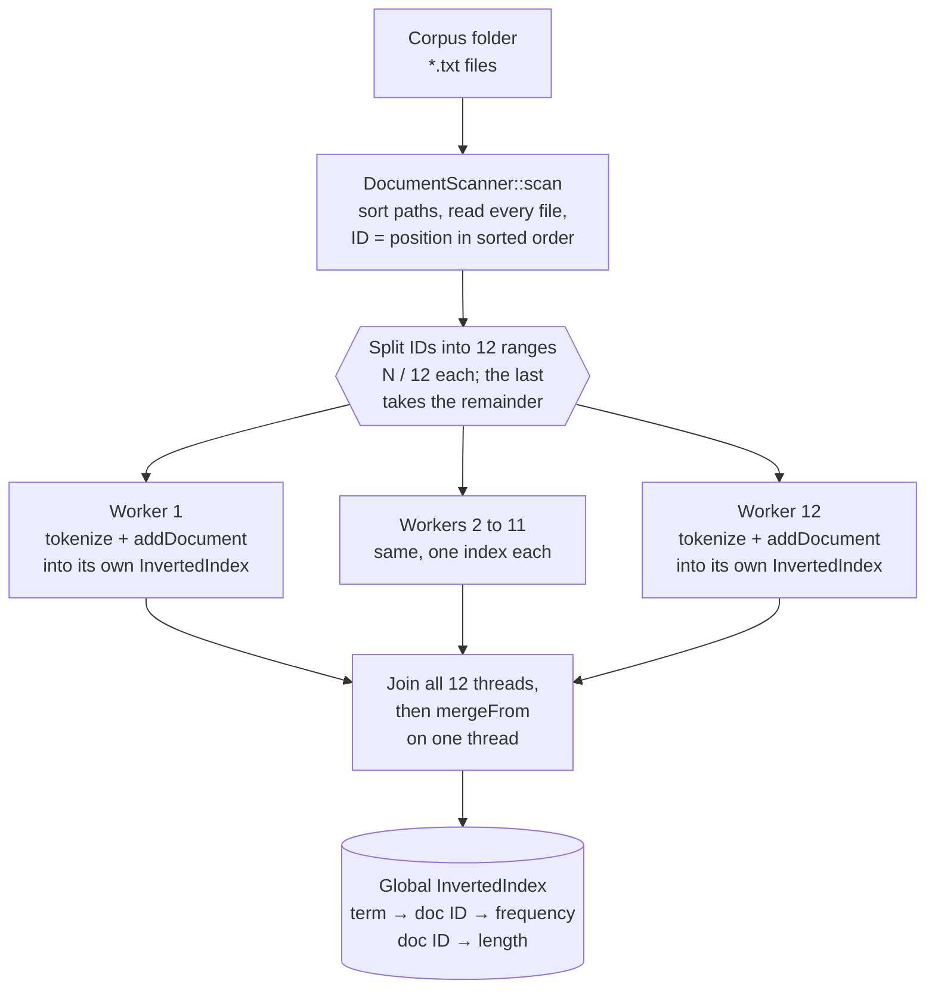
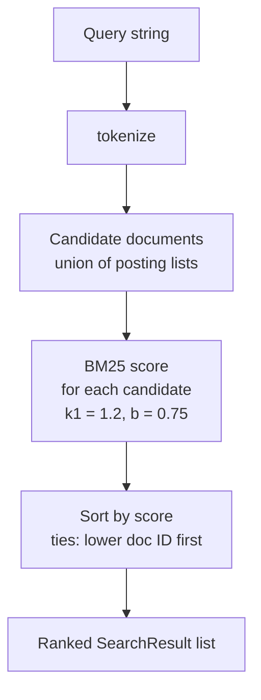

# C++ File Search Engine

A full-text search engine for local text files, written from scratch in modern C++20. It builds an inverted index over a folder of `.txt` documents, ranks matches with the **Okapi BM25** relevance function, and splits indexing across **12 worker threads** that each build a private index before a single-threaded merge.

The project uses no third-party libraries — only the C++ standard library — and is built with MSVC in Visual Studio on Windows.


-5C2D91)

[](LICENSE)

## Contents

- [Features](#features)
- [Architecture](#architecture)
- [Indexing pipeline](#indexing-pipeline)
- [Search pipeline](#search-pipeline)
- [Technology](#technology)
- [Building and running](#building-and-running)
- [Usage](#usage)
- [Benchmarks](#benchmarks)
- [Repository structure](#repository-structure)
- [Limitations](#limitations)
- [Roadmap](#roadmap)
- [License](#license)

## Features

| Feature | Implementation |
| --- | --- |
| Document discovery | Scans one folder (non-recursive) for regular `.txt` files and sorts the paths, so document IDs are deterministic between runs. |
| Tokenization | Lower-cased runs of ASCII letters and digits; keeps `+` and `#` attached to a word, so `C++` and `C#` stay searchable. |
| Inverted index | `term → {document ID → term frequency}`, plus the token length of every document. |
| BM25 ranking | Okapi BM25 with `k1 = 1.2` and `b = 0.75`, using a non-negative IDF. |
| Keyword search | Returns every document that contains at least one query term, sorted by score. |
| Parallel indexing | 12 `std::jthread` workers, each with its own `InvertedIndex`; no locks are needed during indexing. |

## Architecture

| Component | Files | Responsibility |
| --- | --- | --- |
| `DocumentScanner` | `DocumentScanner.h/.cpp` | Lists `.txt` files in a folder, sorts them, and reads each file into a `Document { path, text }`. |
| `tokenize()` | `Tokenizer.h/.cpp` | Splits text into normalized tokens. Used for both documents and queries. |
| `InvertedIndex` | `InvertedIndex.h/.cpp` | Stores postings and document lengths, answers term/document statistics, and merges another index into itself (`mergeFrom`). |
| `BM25Ranker` | `BM25Ranker.h/.cpp` | Scores one document against a query using statistics from the index. |
| `SearchEngine` | `SearchEngine.h/.cpp` | Owns the documents, the index and the ranker. Its constructor runs the indexing pipeline; `search()` runs the query pipeline. |
| CLI | `main.cpp` | Builds a `SearchEngine` for a folder, reads queries from standard input, and prints ranked results. |

**Indexing** runs once, in the `SearchEngine` constructor:



**Search** runs for every query, in `SearchEngine::search`:



## Indexing pipeline

All indexing happens in the `SearchEngine` constructor.

1. **Scan.** `DocumentScanner::scan` iterates the folder with `std::filesystem::directory_iterator`, keeps regular files whose extension is `.txt`, and sorts the paths. Each file is read in full into a `std::string`. A file that cannot be opened is reported on `stderr` and skipped. A document's ID is its position in this sorted list.
2. **Partition.** The document list is split into 12 contiguous ID ranges of `N / 12` documents (integer division). The last worker also takes the remainder, so every document is indexed exactly once even when `N` is not a multiple of 12. With the 10,000-document benchmark corpus, workers 1–11 index 833 documents each and worker 12 indexes 837.
3. **Index in parallel.** Each `std::jthread` loops over its range and calls `addDocument` on its own `InvertedIndex`. That call tokenizes the text, records the document's token count, and increments `postings[token][documentId]`. The workers only *read* the shared document list and only *write* to their own index, so this stage needs no mutexes or atomics.
4. **Join.** The constructor joins all 12 threads explicitly before the local indexes are used.
5. **Merge.** On the calling thread, `mergeFrom` copies each worker's document lengths and postings into the global index. Document ID ranges never overlap, so merging is plain insertion with no conflict resolution.

Scanning, file reading and merging all run on one thread; only tokenization and posting construction run in parallel.

## Search pipeline

`SearchEngine::search(query)`:

1. **Tokenize** the query with the same tokenizer used for documents.
2. **Collect candidates:** the union of the posting lists of every query term. A document matches if it contains *any* query term (OR semantics).
3. **Score** each candidate with `BM25Ranker::scorer`. Repeated query terms are counted once.
4. **Rank** by score, highest first; equal scores are ordered by document ID.
5. **Return** every candidate as a `SearchResult { documentId, bm25Score, filePath }`.

The score for document $D$ and query $Q$ is

$$
\text{score}(D, Q) = \sum_{t \in Q} \text{IDF}(t) \cdot \frac{f(t, D)\,(k_1 + 1)}{f(t, D) + k_1 \left(1 - b + b \cdot \frac{|D|}{\text{avgdl}}\right)}
\qquad
\text{IDF}(t) = \ln\!\left(1 + \frac{N - n(t) + 0.5}{n(t) + 0.5}\right)
$$

where $f(t, D)$ is the number of times term $t$ appears in $D$, $|D|$ is the document's length in tokens, $\text{avgdl}$ is the average document length, $N$ is the number of documents, and $n(t)$ is the number of documents containing $t$. The constants are $k_1 = 1.2$ and $b = 0.75$.

## Technology

| Area | Details |
| --- | --- |
| Language | C++20 (`/std:c++20`), conformance mode (`/permissive-`) |
| Compiler / IDE | MSVC, Visual Studio platform toolset **v145**, solution file `C++File_Search_Engine.slnx` |
| Concurrency | `std::jthread`, `std::array` of per-worker `InvertedIndex` objects |
| Data structures | `std::unordered_map`, `std::unordered_set`, `std::vector` |
| File I/O | `std::filesystem::directory_iterator`, `std::ifstream` |
| Timing (benchmark) | `std::chrono::steady_clock` |
| Dependencies | None beyond the standard library |

## Building and running

**Requirements:** Windows, and Visual Studio with the *Desktop development with C++* workload and platform toolset v145 (the toolset the project is configured for). Other toolset versions have not been tested.

1. Clone the repository:

   ```powershell
   git clone https://github.com/jagritsinghsheoran-bit/cpp-file-search-engine.git
   ```

2. Open `C++File_Search_Engine.slnx` in Visual Studio.
3. Set the folder to index. The path is hard-coded in `C++File_Search_Engine/src/main.cpp`:

   ```cpp
   const std::filesystem::path directoryPath =
       R"(C:\Users\jagri\OneDrive\Desktop\SearchEngineFile)";
   ```

4. Select the **Release | x64** configuration and build with **Build → Build Solution** (`Ctrl+Shift+B`).
5. Run with **Debug → Start Without Debugging** (`Ctrl+F5`). The executable is written to `x64\Release\C++File_Search_Engine.exe`.

## Usage

The program indexes the folder at startup, then reads one query per line from standard input. Type `exit` to stop entering queries; results for all queries are then printed in order.

```text
Enter queries (type 'exit' to finish):
mutex deadlock
Belstavi
zzznotaword
exit
```

Output on the benchmark corpus, abridged (the first query matches 3,673 documents and all of them are printed):

```text
Query: "mutex deadlock"
File: document_08340.txt
Document ID: 8340
BM25 Score: 6.18678
-------------------------
File: document_05121.txt
Document ID: 5121
BM25 Score: 6.10692
-------------------------
File: document_02246.txt
Document ID: 2246
BM25 Score: 6.09374
-------------------------
...

Query: "Belstavi"
File: document_00000.txt
Document ID: 0
BM25 Score: 16.224
-------------------------

Query: "zzznotaword"
No results found.
```

Queries are case-insensitive and punctuation is ignored, so `Mutex, DEADLOCK!` is equivalent to `mutex deadlock`. A blank query returns no results.

## Benchmarks

### Method

| Item | Value |
| --- | --- |
| What is timed | Construction of `SearchEngine`: folder scan, reading every file, tokenization and indexing, and merging the worker indexes. Query time is **not** included. |
| Timer | `std::chrono::steady_clock`, around the constructor call (`benchmarks/Benchmark.cpp`) |
| Build | Release, x64, MSVC (toolset v145) |
| Corpus | 10,000 synthetic `.txt` documents, 100.0072 MiB in total, at `C:\SearchEngineBenchmarkCorpus` |
| Hardware | Intel Core i5-12450H: 8 cores (4 performance + 4 efficient), 12 threads |
| Repetitions | 5 runs per configuration; the median is reported |
| Cache state | Likely warm: the corpus had been read recently, so files were probably served from the OS file cache. Cold-cache performance was not measured. |

Each worker count was measured with the commit that introduced it. Every multi-worker version uses the same design (contiguous ranges, per-worker indexes, merge after join); only the number of workers differs. The current code is the 12-worker version.

### Results

| Workers | Median time (s) | Fastest – slowest (s) | Throughput at median (MiB/s) | Speedup vs. sequential |
| ---: | ---: | :---: | ---: | ---: |
| 1 (sequential) | 3.2403 | 3.2078 – 3.3270 | 30.86 | 1.00× |
| 2 | 3.1880 | 3.1608 – 3.2399 | 31.37 | 1.02× |
| 4 | 2.6227 | 2.6205 – 2.7626 | 38.13 | 1.24× |
| 8 | 2.3858 | 2.3575 – 2.4132 | 41.92 | 1.36× |
| **12 (current)** | **2.2973** | **2.2464 – 2.3174** | **43.53** | **1.41×** |

Speedup is the sequential median divided by the configuration's median. Every individual run is listed in [`benchmarks/results.csv`](C++File_Search_Engine/benchmarks/results.csv), with a console screenshot of each run in [`benchmarks/screenshots`](C++File_Search_Engine/benchmarks/screenshots) (one folder per configuration, `run1.png`–`run5.png` matching the CSV run numbers).

### Interpretation

- With 12 workers, indexing the corpus takes a median of 2.30 s instead of 3.24 s, which is **1.41× faster**. That is a real but modest gain for 12 hardware threads.
- Two workers made almost no difference: their run times overlap the sequential runs' range.
- Most of the improvement arrives by 4 workers, and each step after that adds less.
- The code was not profiled, so the causes of the limited scaling are not established. Likely contributors are:
  - the parts of construction that are still single-threaded: scanning, reading every file, and the final merge;
  - the large number of small heap allocations made when filling `std::unordered_map` postings;
  - the CPU's mix of performance and efficient cores.

### Not measured

Query latency, memory usage, cold-cache indexing, and other machines or corpora have not been measured, so no figures are given for them.

### Running the benchmark

`benchmarks/Benchmark.cpp` has its own `main()`, so it is commented out while the CLI in `main.cpp` is built. To run it:

1. In Solution Explorer, open the properties of `src\main.cpp` and set **Excluded From Build** to **Yes** for Release | x64.
2. In `benchmarks/Benchmark.cpp`, remove the `/*` and `*/` that enclose the file, and set `directoryPath` to your corpus folder.
3. Build **Release | x64** and run it with `Ctrl+F5`. Each run prints the document count, corpus size, documents/s, MiB/s and indexing time.

## Repository structure

```text
cpp-file-search-engine/
├── C++File_Search_Engine.slnx              Visual Studio solution
├── LICENSE
├── README.md
└── C++File_Search_Engine/
    ├── C++File_Search_Engine.vcxproj       Project: C++20, x64/Win32, Debug/Release
    ├── C++File_Search_Engine.vcxproj.filters
    ├── include/
    │   ├── BM25Ranker.h
    │   ├── DocumentScanner.h
    │   ├── InvertedIndex.h
    │   ├── SearchEngine.h
    │   └── Tokenizer.h
    ├── src/
    │   ├── BM25Ranker.cpp
    │   ├── DocumentScanner.cpp
    │   ├── InvertedIndex.cpp
    │   ├── SearchEngine.cpp                Indexing (12 workers) and search
    │   ├── Tokenizer.cpp
    │   └── main.cpp                        Interactive CLI
    └── benchmarks/
        ├── Benchmark.cpp                   Indexing-time benchmark (commented out by default)
        ├── results.csv                     All recorded runs
        └── screenshots/                    Console output of every run
            ├── sequential/                 run1.png … run5.png
            └── workers-02/ … workers-12/   run1.png … run5.png
```

## Limitations

- **Hard-coded settings.** The corpus folder is set in source (`main.cpp`, `Benchmark.cpp`), and the worker count is fixed at 12 by twelve explicitly written threads.
- **Tokenizer is ASCII-only.** Bytes outside ASCII split words, and there is no stemming or stop-word removal.
- **Only `.txt` files in one folder are indexed.** Subfolders are not searched.
- **All matches are printed.** There is no top-*k* limit, so a common word can print thousands of results.
- **Search is single-threaded**, and the average document length is recomputed over all documents for every term scored rather than cached.
- **Memory.** The full text of every document stays in memory after indexing.
- **Errors.** A file that cannot be opened is skipped with a message that does not name the file. Worker threads have no exception handling.

## Roadmap

### Completed

- [x] Sequential indexing and BM25 keyword search
- [x] Parallel indexing with 12 workers using per-worker indexes and a merge step
- [x] Repeated-run benchmarks for 1, 2, 4, 8 and 12 workers, recorded in `results.csv` with screenshots
- [x] Documentation of the architecture, pipelines, build steps and benchmark method (this README)

### Planned

- [ ] **Automated tests.** Cover search, BM25 scoring, empty queries, missing terms, and several small document collections.
- [ ] **Validate parallel indexing.** Add a test that the 12-worker index produces the same search results as a sequential index, including document counts that do not divide evenly by 12.
- [ ] **Phrase search.** Support quoted queries such as `"machine learning"`. This requires storing word positions in the postings, which currently hold only term counts.
- [ ] **Index persistence.** Save the built index to disk and load it on the next run instead of re-indexing every document.

## License

Released under the [MIT License](LICENSE). Copyright © 2026 Jagrit Singh Sheoran.
